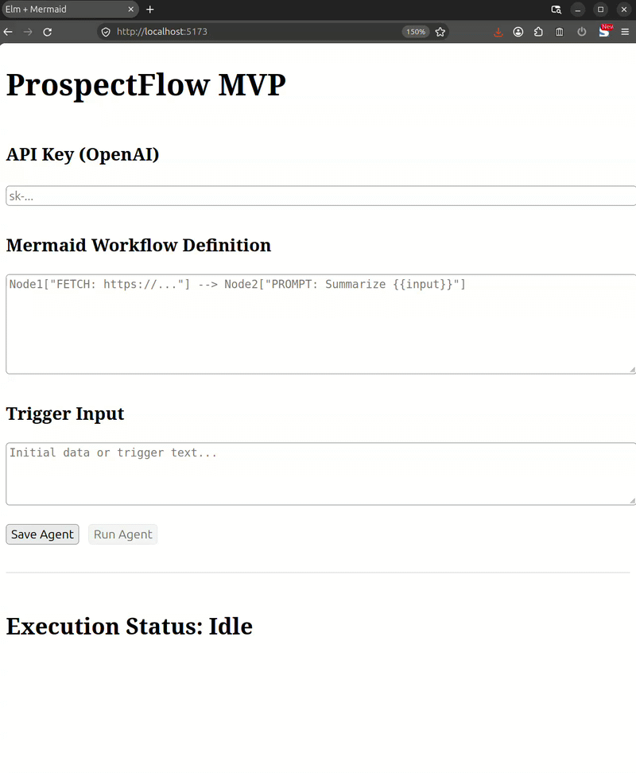

# ProspectFlow

ProspectFlow é um MVP em Elm de um motor de fluxos (workflows) de LLM baseado em texto. A aplicação permite definir um pipeline sequencial de enriquecimento de dados e prompts de LLM usando uma sintaxe limitada do Mermaid.js. O frontend em Elm (The Elm Architecture) envia o fluxo para um backend FastAPI, onde um motor em Prolog o executa.



## Funcionalidades

- **Execução no Backend:** Os fluxos são executados por uma máquina de estados em Prolog, exposta por um endpoint FastAPI (`POST /execute`).
- **Parser de Mermaid:** O Elm valida o fluxo com `elm/parser` (`FlowParser.elm`), sem regex, e o Prolog o lê de novo no backend (`fsm.pl`) para executar.
- **Máquina de Estados do Fluxo:** O `fsm.pl` executa as etapas em sequência, e a saída do `FETCH` vira o token `{{input}}` da etapa seguinte.
- **Ações HTTP:** Suporta três ações principais:
  - `FETCH`: Busca texto de uma URL especificada via HTTP GET.
  - `PROMPT`: Envia o conteúdo para a API `gpt-4o-mini` da OpenAI.
  - `POST`: Envia a saída da etapa anterior, encapsulada em um JSON, para uma URL de webhook especificada via HTTP POST.
- **Log de Execução:** Mostra em tempo real o estado da execução do pipeline (Ocioso, Executando, Concluído ou Falhou) e a saída de cada etapa.

## Primeiros Passos

### Pré-requisitos

- [Node.js](https://nodejs.org/) (v20+ recomendado)
- [pnpm](https://pnpm.io/)
- [Elm](https://guide.elm-lang.org/install/elm.html) (0.19.1+), instalado globalmente (o comando `elm` precisa estar no PATH; veja a nota abaixo)
- [Docker](https://www.docker.com/) (ou [uv](https://docs.astral.sh/uv/) + [SWI-Prolog](https://www.swi-prolog.org/) para rodar o backend sem Docker)

### Instalação

1. Suba o backend (`http://localhost:8000`) a partir da raiz do repositório:
   ```bash
   docker compose up --build
   ```
   Sem Docker: `cd backend && uv sync && ENVIRONMENT=dev uv run fastapi dev app/main.py` (`ENVIRONMENT=dev` habilita o CORS para o frontend).

2. Em outro terminal, instale as dependências do frontend (o app em Elm fica em `frontend/`, não em `frontend/prospectflow/`):
   ```bash
   cd frontend
   pnpm install
   ```

3. Inicie o servidor de desenvolvimento:
   ```bash
   pnpm exec vite
   ```

4. Abra o navegador na URL local informada pelo Vite (ex.: `http://localhost:5173`).

> **Nota sobre o compilador Elm:** o `vite-plugin-elm` procura o `elm` primeiro em `node_modules/.bin` (da pasta atual e das pastas acima) e só depois no PATH. Não instale o pacote npm `elm` com pnpm neste repositório: o atalho que o pnpm cria executa `node bin/elm`, mas esse arquivo é substituído pelo binário nativo na instalação, e o Vite falha com `elm make failed: ... SyntaxError: Invalid or unexpected token`. Se aparecer esse erro, apague o `node_modules` que contém o `elm` (inclusive um eventual `node_modules` na raiz do repositório) e use o Elm instalado globalmente (`elm --version` deve funcionar no terminal).

## Uso

1. **Informe a API Key:** Forneça sua chave da API da OpenAI (começando com `sk-...`).
2. **Defina o Fluxo:** Escreva um pipeline linear usando a sintaxe limitada do Mermaid. Exemplo:
   ```mermaid
   graph TD
      start["FETCH: https://jsonplaceholder.typicode.com/posts/1"]
      summarize["PROMPT: Summarize the following JSON: {{input}}"]
      send["POST: https://httpbin.org/post"]
      abort["ABORT"]
      done["DONE"]

      start -->|fetch_succeeded| summarize
      start -->|fetch_failed| abort
      summarize -->|summary_generated| send
      summarize -->|generation_failed| abort
      send -->|request_succeeded| done
      send -->|request_failed| abort
   ```
3. **Entrada de Disparo:** Forneça qualquer dado inicial para disparar o fluxo. Ele substituirá o token `{{input}}` no primeiro nó.
4. **Executar e Salvar:** Clique em "Executar Agente" e acompanhe o log em "Status de Execução". Para guardar o fluxo, dê um nome e clique em "Salvar fluxo"; ele aparece na lista "Fluxos salvos".

## Arquitetura

```
Elm (navegador) --HTTP/JSON--> FastAPI --pyswip--> Prolog (SWI-Prolog)
```

O Elm cuida da interface e valida o que dá para validar localmente. O Prolog executa os fluxos e guarda os fluxos salvos. O Python só faz a integração.

### Frontend (`frontend/`)

| Arquivo | Responsabilidade |
|---------|------------------|
| `main.js` | Inicia o app Elm, define o `<mermaid-element>` (pré-visualização do diagrama) e guarda a chave de API no `localStorage` |
| `src/Main.elm` | Ponto de entrada: `init`, `update` e o port `saveApiKey` |
| `src/Types.elm` | Modelo, `Msg` e os tipos de estado (`ExecutionState`, `SavedFlows`, `FlowFilter`, `StorageStatus`) |
| `src/View.elm` | Tela principal: chave de API, fluxo, gatilho, botão de executar e log |
| `src/StorageView.elm` | Tela de fluxos salvos: salvar, listar, filtrar por tipo de nó, abrir e apagar |
| `src/Api.elm` | Chamada `POST /execute` |
| `src/StorageApi.elm` | Chamadas `/fluxos` (salvar, listar, abrir, apagar) |
| `src/Translations.elm` | Textos em PT e EN, um construtor `TextId` por texto |
| `src/Domain.elm` | Tipos do domínio (`Flow`, `Node`, `Edge`, ids opacos) e validação: nó duplicado, ligação para nó inexistente e ciclo |
| `src/FlowParser.elm` | Parser com `elm/parser` que transforma o texto Mermaid em `Flow`, com o número da linha em cada erro |
| `src/PrologApi.elm`, `src/PrologReport.elm`, `src/ReportView.elm` | Cliente, decoder e tela do relatório de análise feito pelo Prolog. Já escritos, mas ainda não ligados ao `Main` |

### Backend (`backend/`)

| Arquivo | Responsabilidade |
|---------|------------------|
| `prolog/fsm.pl` | Lê o diagrama Mermaid e executa o fluxo como máquina de estados (`FETCH`, `PROMPT`, `POST`, `ABORT`, `DONE`) |
| `prolog/armazenamento.pl` | Fluxos salvos como fatos persistentes (`library(persistency)`) e consultas como `fluxos_com_tipo/2` |
| `app/main.py` | FastAPI: `POST /execute` e CORS em desenvolvimento |
| `app/rotas_fluxos.py` | Rotas `/fluxos` |
| `app/prolog.py`, `app/armazenamento.py` | Ponte Python → Prolog com `pyswip` |

Testes: `backend/prolog/test_armazenamento.pl` (plunit) e `backend/tests/` (pytest).

## Licença

Este projeto é open-source e está disponível sob a licença MIT.
