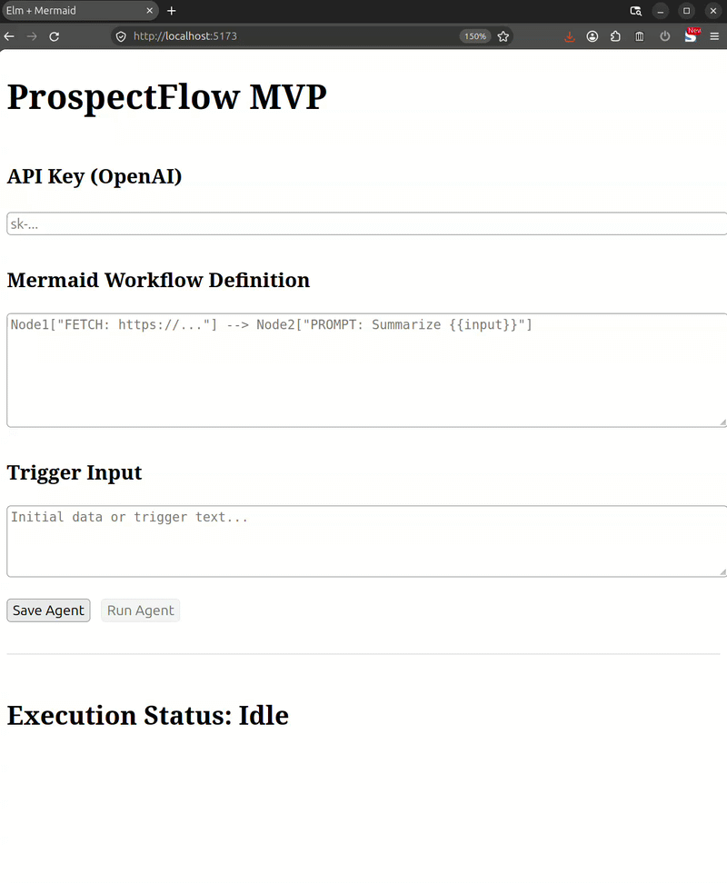

# ProspectFlow

## 1. Identificação

| Nome completo | Matrícula | Turma (14h/16h) | Usuário GitHub |
|---------------|-----------|-----------------|----------------|
| Eduarda Domingos Rodrigues       | 231026699  | 16h           | [@eduardar0](https://github.com/eduardar0)     |
| Eduardo de Almeida Ferreira       | 221008632  | 16h           | [@eduardoferre](https://github.com/eduardoferre)     |
| Eduardo de Almeida Morais        | 231011275  | 16h           | [@Edumorais08](https://github.com/Edumorais08)     |
| Leonardo Michalski Miranda       | 190046945  | 16h           | [@leomichalski](https://github.com/leomichalski)     |
| Letícia de Carvalho dos Santos   | 222022135 | 16h           | [@LeticiaSantoss](https://github.com/LeticiaSantosss)|
| Maria Samara Alves Silva        | 231027005  | 16h          | [@SamaraAlvess](https://github.com/SamaraAlvess)     |
| Yan Lucas Souza Guimarães       | 222006220   | 16h           | [@yanzin00](https://github.com/yanzin00)     |

- **Nome do projeto:** ProspectFlow
- **Nome do grupo:** Lambda Squad
- **Repositório:** https://github.com/leomichalski/paradigmas-trabalho
- **Commit ou tag entregue:** `v1.0`
- **Ponto de partida:** inspirado em plataformas de automação de workflows, como o n8n.
- **Slides da apresentação oral:** https://docs.google.com/presentation/d/1DPOFrzh4NuB9V1EEUNQG9a80Z1trTprwma9aimZj_W4/edit?usp=sharing

## 2. Resumo

ProspectFlow é um editor e executor de fluxos de automação com LLM, descritos em texto com uma sintaxe limitada do Mermaid. O frontend em Elm envia o fluxo para um backend FastAPI, e o Prolog executa o fluxo como uma máquina de estados (cada nó dispara um evento que escolhe o próximo passo), analisa o grafo e guarda os fluxos salvos como uma base de fatos consultável.



## 3. Como executar

**Requisitos** (com as versões que o grupo usou):

- [Node.js](https://nodejs.org/) (v20+ recomendado)
- [pnpm](https://pnpm.io/)
- O compilador do Elm (0.19.1) e o `elm-format` vêm pelo `pnpm install`, dentro de `frontend/node_modules`. Não precisa instalar o Elm globalmente.
- [Docker](https://www.docker.com/) para rodar o backend.

**Instalação e execução:**

1. Suba o backend (`http://localhost:8000`) a partir da raiz do repositório:
   ```bash
   docker compose up --build
   ```

2. Em outro terminal, instale as dependências do frontend (o app em Elm fica em `frontend/`, não em `frontend/prospectflow/`):
   ```bash
   cd frontend
   pnpm install
   ```

3. Inicie o servidor de desenvolvimento:
   ```bash
   pnpm exec vite
   ```

4. Abra o navegador na URL local informada pelo Vite (ex.: `http://localhost:5173`).

> **Nota sobre o compilador Elm:** os pacotes `elm` e `elm-format` baixam o binário de verdade durante a instalação. O pnpm bloqueia esse passo por padrão, por isso o `frontend/pnpm-workspace.yaml` libera os dois em `allowBuilds`. Se o Vite falhar com `elm make failed: ... SyntaxError: Invalid or unexpected token`, o binário não foi baixado: apague o `frontend/node_modules` e rode `pnpm install` de novo.

**Testes:**

```bash
make test          # Prolog (plunit) + backend (pytest) + frontend (elm-test)
make test-elm      # só os testes do frontend
```

**Testado em:** Linux, Firefox

## 4. Arquitetura

```
[Elm] --HTTP/JSON--> [Python/FastAPI] --PySwip--> [Prolog]
```

| Parte  | Responsabilidade | Arquivos principais |
|--------|------------------|---------------------|
| Prolog | Interpretação dos diagramas Mermaid, análise de grafos, detecção de ciclos e nós inalcançáveis, cálculo dos níveis de paralelismo, execução e armazenamento dos workflows. | `backend/prolog/fsm.pl`, `backend/prolog/graph.pl`, `backend/prolog/armazenamento.pl` |
| Elm    | Interface no navegador: editor do fluxo com pré-visualização do diagrama, execução e log, escolha do provedor de IA, fluxos salvos e tradução PT/EN; tipos do domínio e parser que validam o fluxo. | `frontend/src/Main.elm`, `frontend/src/View.elm`, `frontend/src/Types.elm`, `frontend/src/StorageView.elm`, `frontend/src/Domain.elm`, `frontend/src/FlowParser.elm` |
| Python | Integração entre Elm e Prolog, exposição das rotas HTTP, validação das entradas e conversão dos resultados para JSON. | `backend/app/main.py`, `backend/app/prolog.py`, `backend/app/rotas_fluxos.py`, `backend/app/armazenamento.py` |

## 5. Parte em Prolog

### 5.1 Predicados principais

**Parte 1 — Análise de grafos:** identifica ciclos e nós inalcançáveis e calcula a ordem topológica e os níveis de paralelismo. Os resultados são disponibilizados pelo endpoint `/analyze` e os níveis orientam o motor de execução.

| Predicado | Local | O que faz |
|-----------|-------|-----------|
| `parse_mermaid_text(+Texto, -Nos, -Transicoes)` | `backend/prolog/fsm.pl:31` | Lê o diagrama Mermaid e devolve termos `node(Id, Acao)` e `transition(Origem, Evento, Destino)`. É o parser usado pelo executor, pela análise e pelo armazenamento |
| `execute_workflow_from_text(+Texto, +Gatilho, +Chave, +Provedor, -Log)` | `backend/prolog/fsm.pl:45` | Ponto de entrada da execução: calcula os níveis do grafo, executa o fluxo e devolve o log |
| `run_levels(+Niveis, +Nos, +Transicoes, +Ativos, +Log0, -Log)` | `backend/prolog/fsm.pl:61` | Percorre os níveis e executa em paralelo os nós ativados pelo evento que de fato ocorreu |
| `run_state(+No, +Nos, +Contexto, -Evento, -NovoContexto, +Log0, -Log)` | `backend/prolog/fsm.pl:86` | Executa um nó (FETCH, PROMPT, POST, ABORT ou DONE) e devolve o evento que ele disparou |
| `llm_provider(?Id, ?Nome, ?Url, ?Modelo)` | `backend/prolog/fsm.pl:37` | Fatos com o endereço e o modelo de cada provedor de IA usado pelos nós PROMPT |
| `encontrar_ciclo(+Nos, +Transicoes, -Ciclo)` | `backend/prolog/graph.pl:38` | Procura um ciclo no fluxo e devolve o caminho dele, como `[a, b, a]` |
| `nos_inalcancaveis(+Nos, +Transicoes, -Inalcancaveis)` | `backend/prolog/graph.pl:19` | Lista os nós que não podem ser alcançados a partir do primeiro nó |
| `niveis_paralelismo(+Nos, +Transicoes, -Niveis)` | `backend/prolog/graph.pl:62` | Agrupa os nós em níveis: os de um mesmo nível não dependem uns dos outros e podem rodar juntos |
| `salvar_fluxo(+Nome, +Texto, +Gatilho)` | `backend/prolog/armazenamento.pl:53` | Grava um fluxo como fatos persistentes (texto, gatilho, nós e transições) |
| `fluxos_com_ligacao(+TipoA, +TipoB, -Nomes)` | `backend/prolog/armazenamento.pl:140` | Consulta os fluxos salvos: "quais fluxos ligam um PROMPT direto a um POST?" |

### 5.2 Conceitos do paradigma lógico utilizados

- [x] Fatos e regras como base de conhecimento: os provedores de IA são fatos `llm_provider/4` (`fsm.pl:37`); os fluxos salvos viram fatos persistentes `fluxo_no/3` e `fluxo_transicao/4` (`armazenamento.pl:31`), consultados por regras (`armazenamento.pl:125-145`).
- [x] Unificação e casamento de padrões: o parser devolve termos `node/2` e `transition/3` (`fsm.pl:18`); o executor encontra a próxima seta unificando `transition(No, Evento, Destino)` com o evento disparado (`fsm.pl:77`); `fluxos_com_ligacao/3` junta três fatos por variáveis compartilhadas (`armazenamento.pl:140`). A extração dos identificadores usa `extrair_ids/2` (`graph.pl:3`) e a relação de arestas usa `aresta/3` (`graph.pl:7`).
- [x] Recursão (inclusive sobre listas): `dfs_ciclo/4` (`graph.pl:27`), `calcular_niveis/3` (`graph.pl:52`), `run_levels/6` (`fsm.pl:61`) e `parse_lines/3` (`fsm.pl:18`). `alcancaveis/3` (`graph.pl:11`) percorre os nós alcançáveis.
- [x] Backtracking e múltiplas soluções: `encontrar_ciclo/3` tenta cada nó de partida e cada aresta por backtracking até achar um ciclo (`graph.pl:38`); `fluxos_com_ligacao/3` devolve todos os fluxos que satisfazem a consulta (`armazenamento.pl:140`).
- [x] `findall/3`, `bagof/3`, `setof/3` ou similares: `findall/3` monta cada nível em `calcular_niveis/3` (`graph.pl:52`) e a lista de nós a executar em `run_levels/6` (`fsm.pl:61`); `setof/3` com `^` lista os fluxos sem repetição (`armazenamento.pl:152`).
- [x] Corte (`!`) ou negação (`\+`), e por que foram necessários: `\+ member/2` impede a busca de ciclo de revisitar um nó do caminho, o que a faria entrar em laço (`graph.pl:35`); `\+ tem_dependencia/3` escolhe os nós sem pai pendente para formar um nível (`graph.pl:56`); o `!` em `encontrar_ciclo/3` para no primeiro ciclo encontrado (`graph.pl:42`).
- [ ] Programação por restrições (CLP(FD) ou outra): não usada.
- [x] Predicados de ordem superior (`maplist`, `foldl`, `include`...): `concurrent_maplist/3` executa os nós de um nível em paralelo e `foldl/4` junta os resultados (`fsm.pl:63-64`); `maplist/3` converte os nomes dos fluxos (`armazenamento.pl:154`).
- [x] Outro: fatos persistentes em arquivo com `library(persistency)`, que continuam salvos depois de reiniciar o servidor (`armazenamento.pl:31`).

### 5.3 Trecho em destaque

```prolog
% backend/prolog/graph.pl:27
dfs_ciclo(Transitions, Atual, Caminho, Ciclo) :-
    aresta(Transitions, Atual, Proximo),
    member(Proximo, Caminho),
    !,
    reverse([Proximo | Caminho], Ciclo).

dfs_ciclo(Transitions, Atual, Caminho, Ciclo) :-
    aresta(Transitions, Atual, Proximo),
    \+ member(Proximo, Caminho),
    dfs_ciclo(Transitions, Proximo, [Proximo | Caminho], Ciclo).

% backend/prolog/graph.pl:38
encontrar_ciclo(Nodes, Transitions, Ciclo) :-
    extrair_ids(Nodes, TodosIds),
    member(Inicio, TodosIds),
    dfs_ciclo(Transitions, Inicio, [Inicio], Ciclo),
    !.
```

A detecção de ciclo é escrita como duas regras, sem pilha nem laço explícito.
A primeira diz **quando há ciclo**: de `Atual` sai uma aresta para um nó que
já está no `Caminho` percorrido. A segunda diz **como continuar**: de `Atual`
sai uma aresta para um nó ainda fora do caminho, que entra nele, e a busca
segue a partir dali.

Quem escolhe qual aresta tentar, e volta atrás quando um caminho não leva a
ciclo, é o backtracking do Prolog. Em `encontrar_ciclo/3`, o `member/2` gera
cada nó como ponto de partida, também por backtracking. A negação
(`\+ member/2`) garante que a busca nunca entra no próprio laço que está
procurando, e o corte (`!`) faz parar no primeiro ciclo encontrado.

A resposta não é só "sim" ou "não": é o próprio caminho (`reverse/2` o põe na
ordem certa). O `/execute` usa esse resultado para recusar o fluxo antes de
executar, com a mensagem `Workflow has a cycle: a -> b -> a`.

## 6. Parte em Elm

### 6.1 Modelo e mensagens

```elm
type alias Model =
    { language : Language
    , workflowText : String
    , triggerInput : String
    , provider : LlmProvider
    , apiKey : String
    , executionState : ExecutionState
    , mermaidError : Maybe String
    , flowName : String
    , savedFlows : SavedFlows
    , flowFilter : FlowFilter
    , storageStatus : StorageStatus
    }

type Msg
    = UpdateWorkflowText String
    | UpdateTriggerInput String
    | ChangeProvider LlmProvider
    | UpdateApiKey String
    | RunAgent
    | GotExecutionResult (Result ApiError ExecutionResponse)
    | GotMermaidError String
    | GotMermaidSuccess
    | ToggleLanguage
    | UpdateFlowName String
    | ChangeFlowFilter FlowFilter
    | SaveFlow
    | OpenFlow String
    | DeleteFlow String
    | GotFlowList (Result ApiError (List String))
    | GotSaveResult String (Result ApiError ())
    | GotOpenResult String (Result ApiError SavedFlow)
    | GotDeleteResult String (Result ApiError ())
```

**Model como Record:** a escolha por um Record permite concentrar o estado de toda a interface em um único lugar imutável. Campos sensíveis como `mermaidError` utilizam `Maybe String` para representar a ausência de erros (estado válido) ou a presença de uma string de erro gerada pelo parser, sem recorrer a ponteiros nulos ou `undefined`.

**Msg como Custom Type:** no Elm, todas as interações do usuário ou respostas assíncronas do backend precisam ser estritamente tipadas. Os construtores do `Msg` encapsulam os dados necessários para as transições de estado, como `GotExecutionResult`, que usa o tipo `Result` nativo para forçar o tratamento explícito de sucessos (`Ok`) e falhas (`Err`) de requisições HTTP, garantindo que a interface nunca quebre por exceções não tratadas.

**Fluxos salvos (`frontend/src/Types.elm:27-67`).**

```elm
type SavedFlows
    = LoadingFlows
    | LoadedFlows (List String)
    | FlowsFailed String

type FlowFilter
    = AllFlows
    | UsingNode NodeType

type StorageStatus
    = NoStorageStatus
    | StorageBusy
    | StorageDone StorageAction String
    | StorageFailed String
```

**`SavedFlows` em vez de `List String` mais um `Bool` de "carregando" e um `Maybe String` de erro:** com três campos soltos, a tela poderia estar "carregando" e "com erro" ao mesmo tempo. Com o custom type, a lista só existe dentro de `LoadedFlows`, e o `case` em `viewList` (`frontend/src/StorageView.elm:153`) é obrigado a tratar os três estados.

**`FlowFilter` usa `NodeType` em vez de `String`:** o filtro só pode ser um tipo de nó que existe. A conversão para a string que o Prolog espera fica num único lugar (`nodeTypeToString`, `frontend/src/StorageApi.elm:118`).

**`StorageDone`** guarda qual ação terminou (`FlowSaved`, `FlowOpened`, `FlowDeleted`) e o nome do fluxo, para a mensagem de confirmação certa.

**Provedor de LLM (`frontend/src/Types.elm:83-117`).**

```elm
type LlmProvider
    = OpenAi
    | Nvidia
    | NvidiaUltra

providerFromId : String -> Maybe LlmProvider
```

**`LlmProvider` em vez de `String`:** o `Model` só guarda um provedor que existe. A string que vai para o backend sai de um único lugar (`providerId`, `Types.elm:92`), e o Python (`Literal` em `backend/app/main.py:31`) e o Prolog (`llm_provider/4`) aceitam os mesmos três valores.

**`providerFromId` devolve `Maybe`**, porque o valor do `<select>` é uma string qualquer. O decoder `onProviderChange` (`frontend/src/View.elm:130`) usa `Decode.andThen` e `Decode.fail` para descartar um id desconhecido, então um provedor inválido nunca vira `Msg`.

O `case` em `apiKeyPlaceholder` (`View.elm:146`) é exaustivo: ao adicionar `NvidiaUltra`, o compilador aponta todo lugar que ainda não trata o novo construtor.

### 6.2 Conceitos do paradigma funcional utilizados

- [x] **Arquitetura Elm (Model, update, view):** estrutura base da SPA no arquivo principal, em que o `update` recebe a mensagem (`Msg`) e o estado atual (`Model`), retornando um novo modelo derivado do original.

- [x] **Custom types e `case` exaustivo:** dicionário tipado de traduções (`Language` e `TextId` em `frontend/src/Translations.elm`) e tratamento exaustivo na função `translate`, garantindo em tempo de compilação que todos os textos existam tanto em PT quanto em EN, sem strings soltas na interface. Os construtores `SavedFlows` e `StorageStatus` obrigam a UI a prever estados de loading e erro.

- [x] **`Maybe` e `Result` no lugar de `null` e exceções:** `providerFromId : String -> Maybe LlmProvider` (`frontend/src/Types.elm:105`) converte a entrada do `<select>`. Respostas da API (`GotExecutionResult`) usam o tipo `Result` (`Ok`/`Err`), forçando a interface a tratar falhas de rede.

- [x] **Funções de ordem superior e aplicação parcial:**  a função `test` no `ApiTest.elm` recebe funções anônimas (ex.: `\_ -> Decode.decodeString...`) como argumento para isolar escopos; a inicialização em `Main.elm` usa `Browser.element`, que recebe as funções `init`, `view`, `update` e `subscriptions` como parâmetros; manipuladores de eventos como `onInput` recebem funções de callback. O uso intensivo do operador pipeline (`|>`) nos testes depende do currying nativo do Elm. Na expressão `|> Expect.equal (Ok (...))`, a função `Expect.equal` (que exige dois parâmetros) recebe apenas o valor esperado, retornando uma nova função parcialmente aplicada que aguarda o valor real avaliado e ejetado pelo lado esquerdo do tubo. 

- [x] **Composição (`|>`, `>>`):** `filterFromString` (`frontend/src/StorageView.elm:121`) com `|>`; `onInput (filterFromString >> ChangeFlowFilter)` no `<select>` do filtro.

- [x] **Decoders e encoders JSON:** `savedFlowDecoder`, que usa `Decode.oneOf` para aceitar fluxos sem gatilho (`frontend/src/StorageApi.elm:92`), e o encoder em `saveFlow` (`frontend/src/StorageApi.elm:63`). Decoder da resposta de `POST /analyze` com `Decode.map3`, que transforma `cycle` e `unreachable_nodes` em achados do relatório (`frontend/src/PrologReport.elm:50`); `onProviderChange` com `Decode.andThen`/`Decode.fail` (`frontend/src/View.elm:130`); campo `provider` no encoder do `/execute` (`frontend/src/Api.elm:30`).

- [x] **Comandos e subscriptions (efeitos controlados):** uso de Elm Ports (`port saveApiKey : String -> Cmd msg` em `frontend/src/Main.elm`) para delegar o salvamento da credencial no `localStorage` do navegador para o JavaScript. Esse efeito colateral impuro é encapsulado através da função `update`, que emite um `Cmd`, preservando a pureza de funções puras no domínio.

- [x] **Imutabilidade e atualização de records:** ao atualizar os dados no `Model` dentro da função `update` (ex.: `( { model | apiKey = txt }, saveApiKey txt )`), o record original não é modificado in-place (como seria feito em JS ou Python); o Elm retorna uma nova cópia do objeto atualizando apenas os valores apontados.

### 6.3 Trecho em destaque

```elm
-- frontend/src/Translations.elm
translate : Language -> TextId -> String
translate lang textId =
    case ( lang, textId ) of
        ( Pt, AppTitle ) ->
            "Editor de Fluxos"

        ( En, AppTitle ) ->
            "ProspectFlow MVP"

        -- [...]
```

A estrutura de internacionalização desenvolvida (i18n) foge da implementação tradicional de chaves e valores estáticos em arquivos JSON. A solução implementada é puramente funcional: ela utiliza uma tupla que cruza dois Custom Types restritos (`Language` com PT/EN e `TextId`, que elenca as seções da interface).

Essa escolha se destaca porque se baseia no Pattern Matching do compilador do Elm para garantir segurança absoluta (`case` exaustivo). Se no futuro um novo botão ou label for adicionado a `TextId`, ou caso o grupo decida dar suporte à língua Espanhola em `Language`, o compilador barrará o "build" da aplicação apontando a linha exata do `case` em `translate` que deixou de atender à nova combinação. Não é uma leitura de string dinâmica passível de falha em runtime, mas sim uma árvore de decisão estrita avaliada estaticamente.

## 7. Integração

| Rota / chamada | Entrada | Saída | Predicado Prolog |
|----------------|---------|-------|------------------|
| `POST /analyze` | `{"diagram_text"}` | `{"valid", "has_cycle", "cycle", "unreachable_nodes", "parallel_levels", "execution_order"}` | `parse_mermaid_text/3` e `analisar_grafo/7` |
| `POST /execute` | `{"api_key", "diagram_text", "trigger_input", "provider"}`; `provider` é `openai`, `nvidia` ou `nvidia_ultra` (padrão `openai`) | `{"status", "message", "logs"}`; 400 se o grafo tiver ciclo ou nó inalcançável; 422 se o provedor for desconhecido | `execute_workflow_from_text/5` |
| `GET /fluxos` | `?tipo=post` (opcional) | `{"fluxos": ["a", "b"]}` | `fluxos_salvos/1` ou `fluxos_com_tipo/2` |
| `POST /fluxos` | `{"nome", "diagram_text", "trigger_input"}` | `{"nome"}`; 400 se o nome for vazio ou o diagrama não tiver nós | `salvar_fluxo/3` |
| `GET /fluxos/{nome}` | — | `{"nome", "diagram_text", "trigger_input"}`; 404 se não existir | `carregar_fluxo/3` |
| `DELETE /fluxos/{nome}` | — | `{"nome"}`; 404 se não existir | `remover_fluxo/1` |

## 8. Testes e validação

- **Análise de grafos (Parte 1):** 8 testes automatizados em `backend/tests/test_graph.py`, utilizando pytest, `TestClient` do FastAPI e integração real com Prolog. Os testes verificam a análise de fluxos sequenciais e paralelos, ordenação topológica, detecção de ciclos e autolaços, identificação de nós inalcançáveis, análise de diagramas vazios, ausência do campo obrigatório `diagram_text` e rejeição de grafos cíclicos pelo endpoint `/execute`.
- **Validação manual da execução paralela (Parte 1):** testes realizados diretamente no Prolog, pelo Swagger e pela interface Elm, utilizando um servidor HTTP local com suporte a requisições concorrentes. Foi validado um workflow completo com NVIDIA NIM (FETCH → PROMPT → dois POSTs paralelos → DONE). Ambos os POSTs receberam a mesma resposta gerada pela IA, retornaram HTTP 200 e iniciaram com aproximadamente 1,8 ms de diferença. Com uma espera controlada de três segundos em cada requisição, a execução conjunta dos POSTs levou aproximadamente três segundos, em comparação com os seis segundos estimados para uma execução sequencial.
- **Frontend (elm-test):** 75 testes em `frontend/tests/` (`make test-elm`), todos sobre funções puras, sem navegador nem backend. `DomainTest` e `FlowParserTest` cobrem os casos de borda do domínio: texto vazio, nó duplicado, ligação para nó não declarado, ciclo (inclusive auto-laço), losango e ligações duplas que não são ciclo, fim de linha do Windows (`\r\n`) e `PROMPT` com dois-pontos no texto. `ApiErrorTest` cobre os formatos de erro do FastAPI (`detail` em texto, em lista no 422, corpo que não é JSON, corpo vazio).
- **Prolog (fsm.pl):** 20 testes plunit em `backend/prolog/test_fsm.pl` (`make test-prolog`), sem depender da internet: 12 do parser (nós, transições, o fluxo do README, cabeçalho e linhas em branco, fim de linha do Windows, texto vazio) e 8 da execução (fluxos que terminam em DONE e em ABORT, ação desconhecida, falha de FETCH e de POST seguindo a transição de falha, log da ação executada, fluxo sem seta para o evento e diagrama sem nós).
- **Execução e provedores de LLM:** testes pytest (`make test-backend`):
  `test_execute_rejects_cycle` (`backend/tests/test_graph.py:129`) roda o
  Prolog de verdade e confere que um fluxo com ciclo é recusado com 400 e o
  ciclo na mensagem (`hello -> send -> hello`) antes de executar qualquer nó;
  `test_execute_passes_provider` e `test_execute_rejects_unknown_provider`
  (`backend/tests/test_api.py:100`, `:112`) conferem que o provedor chega ao
  Prolog e que um provedor fora da lista (`gemini`) é recusado com 422.
- **Roteiro manual:** executar o fluxo de exemplo do README com cada um dos três
  provedores e conferir no log a linha `Executing PROMPT with <provedor>
  (<modelo>)`; executar um fluxo com ciclo e conferir a mensagem de erro com o
  ciclo na tela.
- **Armazenamento (parte 2):** 24 testes plunit em
  `backend/prolog/test_armazenamento.pl` (`make test-prolog`) e 14 testes
  pytest das rotas em `backend/tests/test_fluxos.py`, rodando o Prolog de
  verdade. Cada teste usa um arquivo de base temporário.
- **Casos de borda do armazenamento:** nome vazio ou só com espaços (recusado,
  400); diagrama sem nós (recusado, 400); fluxo inexistente (404); salvar de
  novo com o mesmo nome (substitui, inclusive o gatilho); nome com espaço e
  acento na URL; fluxo sem gatilho aberto depois de um com gatilho (o campo é
  limpo); fluxos salvos antes de existir o gatilho (abrem com gatilho vazio);
  fechar e reabrir a base (os fluxos continuam lá); nome com aspas e
  parênteses, como `x"), halt, ("`, que é guardado como texto e não vira
  código Prolog.

- **Interface Visual e Integração (Parte 6):** Roteiro de testes manuais focados na persistência e reatividade da SPA (Single Page Application).
- **Casos de borda visuais:** 
Persistência Segura: Atualizações de página (F5) não perdem a Chave de API, validando o isolamento via Elm Ports e localStorage. Estado Imutável: A alternância do idioma (PT/EN) não interfere no fluxo desenhado nem apaga o grafo visualizado.

- **Domínio e tela de análise (Parte 4):** os casos de borda do parser e do
  domínio estão nos testes `DomainTest` e `FlowParserTest`, descritos acima.
  Roteiro manual da tela (`pnpm exec vite`), com o fluxo de exemplo do README
  colado no campo do fluxo:
  - o fluxo de exemplo aparece como válido, com a contagem de nós e de
    ligações e a indicação de que não há ciclos;
  - trocar uma ação por uma desconhecida (`VOAR: x`) mostra o erro com o número
    da linha;
  - escrever uma linha sem sentido mostra o erro de linha inválida, e vários
    erros aparecem juntos, não só o primeiro;
  - adicionar uma ligação do `done` de volta ao primeiro nó (`start`) mostra
    os nós do ciclo;
  - apagar todo o texto faz o painel de análise sumir;
  - clicar em "Consultar Prolog" com o backend desligado mostra a mensagem de
    falha da consulta e deixa o resto da tela funcionando;
  - editar o texto depois de uma consulta descarta o relatório antigo, porque
    ele descreve o texto anterior.

## 9. Limitações e problemas conhecidos

- **Análise estrutural do grafo:** os níveis de paralelismo são calculados considerando todas as conexões do grafo. Entretanto, a execução de cada nó depende dos eventos produzidos durante o workflow.
- **Melhorias futuras:** implementar estratégias para combinar os resultados de ramificações paralelas e aprimorar a identificação do estado final da execução.
- Na execução em paralelo, se um nó tem dois pais ativados, vale o contexto
  (`{{input}}`) do primeiro; as saídas dos dois pais não são combinadas
  (`fsm.pl:57-59`).
- Fluxos com ciclo não são executados: `/execute` os recusa com 400, então
  laços de repetição (ex.: tentar de novo um FETCH que falhou) não são possíveis.
- O modelo NVIDIA NIM Ultra (550B) é bem mais lento que os outros; o nó PROMPT
  não tem tempo limite configurável.

- **Tratamento do resultado da execução:** o status de sucesso da requisição HTTP não distingue necessariamente um workflow finalizado em DONE de um finalizado em ABORT.

## 10. Contribuição de cada integrante

| Integrante | Principais contribuições |
|------------|--------------------------|
| Eduarda Domingos Rodrigues | Parte 4 (Elm): domínio do fluxo (`Domain.elm`: `NodeId`, `Url`, `NodeKind`, `Flow` opaco e detecção de ciclos pelo algoritmo de Kahn); parser de linhas com `elm/parser` e erros com número da linha (`FlowParser.elm`); tela que mostra os problemas do fluxo e os achados do Prolog (`ReportView.elm`, `PrologReport.elm`). |
| Eduardo de Almeida Ferreira | Testes plunit do motor de fluxos (`fsm.pl`) com o alvo no `make test-prolog`; configuração do `elm-test` e do `make test-elm`, com testes de `Domain` (ids, eventos, URLs, nó duplicado, ligação para nó inexistente e ciclos) e de `FlowParser` (erros de sintaxe com número da linha) em `frontend/tests/`; módulo `ApiError.elm`, que guarda o `detail` das respostas de erro do FastAPI para a tela mostrá-lo, e `ExecutionOutcome` no lugar do `status` em `String`; remoção da inicialização duplicada do Elm e do Mermaid no `index.html`; atualização da seção de arquitetura e de uso do README. |
| Eduardo de Almeida Morais | Parte 2: armazenamento de fluxos como fatos em Prolog (`armazenamento.pl`) e testes plunit; rotas `/fluxos` e pytest; tela "Fluxos salvos" em Elm (`StorageView.elm`, `StorageApi.elm`); gatilho salvo junto com o fluxo; correções de configuração (versão do Elm, CORS, `make test-prolog`). |
| Leonardo Michalski Miranda | Setup e documentação iniciais do projeto; criação da primeira versão do projeto que executava um fluxo sequencial com nós FETCH, PROMPT ou POST; uso de IA para documentação do projeto e para parsing de diagramas Mermaid; refatoração do motor de execução para utilização de Prolog em vez de somente Elm; revisões e ajustes para garantir a integração do sistema. |
| Letícia de Carvalho dos Santos | Parte 1 — Análise de grafos: implementação da análise de grafos em Prolog (`graph.pl`), incluindo detecção de ciclos por DFS, identificação de nós inalcançáveis, ordenação topológica e cálculo dos níveis de paralelismo; integração Python–Prolog e implementação do endpoint `/analyze`; contribuição aos testes automatizados de análise de grafos (`test_graph.py`); correção do predicado `next_transition/4` e da validação de nós inalcançáveis no `/execute`; validação manual da execução paralela pelo Prolog, Swagger e interface Elm, incluindo a execução de um workflow completo com NVIDIA NIM e dois POSTs concorrentes. |
| Maria Samara Alves Silva | Interface de usuário e integração frontend em Elm. Implementou a internacionalização (i18n) segura através de Custom Types (`Translations.elm`); desenvolveu a persistência da Chave de API utilizando `Elm Ports` e `localStorage` via JavaScript (`main.js` e `Main.elm`); criou o feedback visual reativo para erros do Parser (`View.elm`). |
| Yan Lucas Souza Guimarães | Execução do fluxo em paralelo por níveis do grafo em Prolog (`run_levels/6`, `run_state/7` em `fsm.pl`, com `concurrent_maplist/3`) e recusa de fluxos com ciclo no `/execute`, com teste pytest; escolha do provedor de LLM para os nós PROMPT (OpenAI, NVIDIA NIM e NVIDIA NIM Ultra 550B): fatos `llm_provider/4` no Prolog, campo `provider` no `/execute` com testes, e o custom type `LlmProvider` com o seletor na tela em Elm (`Types.elm`, `View.elm`, `Api.elm`); correção do frontend para chamar `/analyze` e decodificar sua resposta (`PrologApi.elm`, `PrologReport.elm`); correções para o app rodar de ponta a ponta (inicialização duplicada do Elm, eventos do PROMPT, imports dos testes, Makefile com pnpm e CORS); tradução do README para português e instruções de execução |

## 11. Fontes, código de terceiros e uso de IA

**Referências.**

- Documentação do SWI-Prolog, incluindo `library(persistency)` e `library(plunit)`: https://www.swi-prolog.org/pldoc/
- Guia oficial do Elm: https://guide.elm-lang.org/
- Pacote `elm/parser`: https://package.elm-lang.org/packages/elm/parser/latest/
- Documentação do FastAPI: https://fastapi.tiangolo.com/
- Documentação do pyswip: https://github.com/yuce/pyswip
- Sintaxe de fluxogramas do Mermaid: https://mermaid.js.org/syntax/flowchart.html

**Uso de ferramentas de IA.**

- **Faixa de uso no código:** intensivo

| Ferramenta | Para que foi usada | Como o grupo verificou o resultado |
|------------|--------------------|------------------------------------|
| ChatGPT / Codex | Leticia Santos (Parte 1) Geração e revisão de trechos de código para análise de grafos em Prolog, integração com Python e testes automatizados. Auxílio na correção de erros e compreensão do código. | Testes automatizados com pytest, consultas no SWI-Prolog e testes manuais pelo Swagger e pela interface Elm, incluindo a validação da execução paralela. |
| Claude | Gerou o código da parte de armazenamento (Prolog do armazenamento, rotas `/fluxos`, tela "Fluxos salvos" em Elm) e os testes; explicou o código e ajudou a configurar o ambiente, porém tudo foi revisado pelo grupo | Testes automatizados (plunit e pytest), roteiro de teste manual na tela, revisão do código e explicação de cada parte |
| Gemini / ChatGPT | Parte Maria Samara (Parte 6). Gerou o código base estrutural para a internacionalização (`Translations.elm`), configuração dos Elm Ports (`Main.elm` e `main.js`) para acesso ao `localStorage`, e ajustes no build do Vite. Também auxiliou na redação do relatório (explicação conceitual de aplicação parcial e currying no paradigma funcional). | Revisão rigorosa de cada trecho para garantir o alinhamento com a The Elm Architecture (TEA). A verificação prática ocorreu zerando os alertas do compilador estrito do Elm, somada ao roteiro de testes manuais no navegador (F5 preservando a chave de API e reatividade imediata da troca de idiomas). |
| Claude (Claude Code) | Parte do Yan: gerou o código e os testes da execução em paralelo por níveis, da escolha do provedor de LLM e da correção do `/analyze` no frontend, e ajudou a diagnosticar os problemas de ambiente (Elm via pnpm, CORS); os commits estão marcados com `Co-Authored-By: Claude` | Testes pytest, `elm make` compilando, execução manual dos fluxos com os três provedores e revisão de cada alteração |
| Claude (chat) | Parte da Eduarda (Parte 4): gerou o código do domínio (`Domain.elm`), do parser (`FlowParser.elm`), da tela de erros e sugestões do Prolog (`ReportView.elm`, `PrologReport.elm`) e a ligação em `Types.elm`, `Main.elm` e `View.elm`, e explicou cada trecho | `elm make` compilando, testes `elm-test` de `Domain` e `FlowParser`, roteiro manual na tela e leitura de cada função |

## 12. Apresentação oral

- **Slides:** https://docs.google.com/presentation/d/1DPOFrzh4NuB9V1EEUNQG9a80Z1trTprwma9aimZj_W4/edit?usp=sharing
- **Roteiro:**

| Parte | Duração | Quem apresenta |
|-------|:-------:|----------------|
| Capa, contexto e arquitetura (Elm → Python → Prolog) | 1,5 min | Leonardo Michalski Miranda |
| Demonstração ao vivo | 3 min | Leonardo Michalski Miranda |
| Prolog: execução paralela (`run_levels/6`, `llm_provider/4`) | 1,5 min | Yan Lucas Souza Guimarães |
| Prolog: detecção de ciclo (`dfs_ciclo/4`) | 1,5 min | Letícia de Carvalho dos Santos |
| Prolog: armazenamento (`fluxos_com_ligacao/3`) | 1,5 min | Eduardo de Almeida Morais |
| Elm: tradução com `case` exaustivo | 1,5 min | Maria Samara Alves Silva |
| Elm: tipos do domínio (`NodeKind`, `NodeId`) | 1,5 min | Eduarda Domingos Rodrigues |
| Elm: `ApiError` e testes | 1,5 min | Eduardo de Almeida Ferreira |
| Limitações e aprendizados | 1,5 min | Eduardo de Almeida Ferreira |

## 13. Reflexão sobre os paradigmas

O paradigma lógico facilitou a representação das relações entre os nós e as transições dos workflows. A utilização de predicados, recursão, unificação e backtracking permitiu implementar a detecção de ciclos, a identificação de nós inalcançáveis e o cálculo dos níveis de paralelismo de forma declarativa.

Uma das principais dificuldades foi a mudança da forma de pensar da programação imperativa para a programação lógica, especialmente na compreensão do mecanismo de busca de soluções do Prolog. A integração com Python também exigiu atenção às diferenças na representação dos dados entre as linguagens, como a distinção entre átomos e strings.

---

